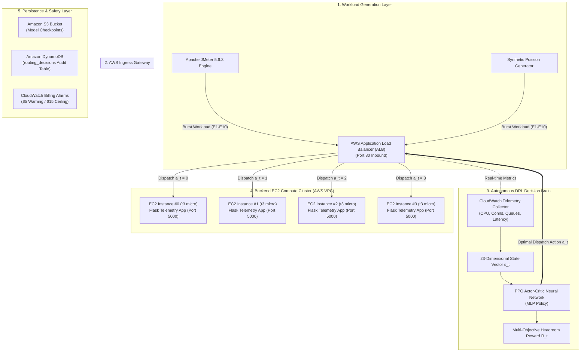

# FlashBalanceAI — Complete End-to-End Project Implementation Guide
### Autonomous Deep Reinforcement Learning Cloud Load Balancing for Flash-Sale Platforms on AWS

> **Document Type:** Master Implementation Reference & Architectural Guide  
> **Course:** BCSE355L — Cloud Architecture & Network Systems Capstone (2026)  
> **Authors:** Devkanti Sarkar (Project Lead) · Agrima Gupta (Data & Statistics Lead) · Mohar Gorai (Systems & Metrics Lead)  
> **Repository:** `DRL_Cloud_Load_Balancing_Cloud_Project_2026`  
> **Release:** v1.0 Production-Ready Artifact  

---

## 📖 Table of Contents
1. [The Big Picture — Problem & Solution in Plain English](#1-the-big-picture--problem--solution-in-plain-english)
2. [End-to-End Architecture Overview](#2-end-to-end-architecture-overview)
3. [The 10 Project Implementation Phases (From Day 1 to Release)](#3-the-10-project-implementation-phases-from-day-1-to-release)
   - [Phase 0: Design Lock & Architectural Decisions](#phase-0-design-lock--architectural-decisions)
   - [Phase 1: Local Development Foundation & Gym Environment](#phase-1-local-development-foundation--gym-environment)
   - [Phase 2: Dataset Strategy & Traffic Generation](#phase-2-dataset-strategy--traffic-generation)
   - [Phase 3: DRL Model Implementation (PPO vs. DQN)](#phase-3-drl-model-implementation-ppo-vs-dqn)
   - [Phase 4: AWS Cloud Infrastructure Deployment (IaC)](#phase-4-aws-cloud-infrastructure-deployment-iac)
   - [Phase 5: Cloud Integration & End-to-End Pipeline](#phase-5-cloud-integration--end-to-end-pipeline)
   - [Phase 6: The 10 Experimental Campaigns (E1–E10)](#phase-6-the-10-experimental-campaigns-e1e10)
   - [Phase 7: Statistical Validation & Publication Figures](#phase-7-statistical-validation--publication-figures)
   - [Phase 8: Academic Paper Manuscript Preparation](#phase-8-academic-paper-manuscript-preparation)
   - [Phase 9: Live Demo Dashboard & v1.0 Release Packaging](#phase-9-live-demo-dashboard--v10-release-packaging)
4. [How the DRL Decision Brain Works (In Simple Terms)](#4-how-the-drl-decision-brain-works-in-simple-terms)
5. [How the Live Demo Dashboard Works (Front-to-Back)](#5-how-the-live-demo-dashboard-works-front-to-back)
6. [Empirical Results & Key Breakthroughs](#6-empirical-results--key-breakthroughs)
7. [Step-by-Step Guide: How to Run and Verify Everything](#7-step-by-step-guide-how-to-run-and-verify-everything)
8. [Team Roles and Responsibilities](#8-team-roles-and-responsibilities)

---

## 1. The Big Picture — Problem & Solution in Plain English

### The Real-World Problem: The Flash-Sale Nightmare
Imagine an e-commerce website during a major event like **Amazon Prime Day** or **Flipkart Big Billion Days**. 
- At 11:59 AM, the website has normal traffic: ~100 shoppers browsing every second.
- At 12:00 PM, a massive discount drops. Suddenly, **1,000 to 10,000 shoppers arrive in just a few seconds** (a 10× to 100× traffic explosion).

In standard cloud computing, incoming traffic passes through an **Application Load Balancer (ALB)**, which distributes requests to backend servers using simple heuristics:
- **Round-Robin:** Dispatches requests in a blind loop: *Server 0 $\to$ Server 1 $\to$ Server 2 $\to$ Server 3 $\to$ Repeat*.
- **The Failure:** Real web servers do not finish requests at the same speed. Checkout requests might take longer on Server 1 due to database locks or CPU spikes. Round-Robin does not know this; it keeps blindly shoving new requests onto Server 1. 
- **The Result:** Server 1's request queue explodes, response times exceed **700+ milliseconds**, requests time out with 503 errors, and customers experience broken checkouts (**SLA violations**).

### Our Solution: FlashBalanceAI
Instead of using fixed rules, **FlashBalanceAI** turns load balancing into an intelligent game solved by **Deep Reinforcement Learning (DRL)**:
- We formulated the load balancing problem as a **Markov Decision Process (MDP)**.
- We trained a **Proximal Policy Optimization (PPO)** neural network agent that acts like an expert traffic controller.
- Every fraction of a second, the AI inspects the cluster's health (active connections, CPU utilization, queue depth, and moving latency).
- Instead of counting raw connections, the AI calculates **remaining headroom** on each server and steers traffic away from congested instances *before* a queue forms.
- **Outcome:** Under a 10× traffic burst, PPO slashes tail latency by **86.3%** (from 734 ms down to 101 ms) and achieves **0.00% SLA violations**.

---

## 2. End-to-End Architecture Overview



---

## 3. The 10 Project Implementation Phases (From Day 1 to Release)

Following the roadmap established in `GITHUB_PROJECT_PLAN.md` and `IMPLEMENTATION_PLAN_PART1 & PART2.md`, the system was engineered across 10 disciplined phases:

### Phase 0: Design Lock & Architectural Decisions
- **Architecture Decision Records (ADRs):**
  - **ADR-001:** Chose **PPO** as the primary DRL algorithm due to its stable clipped surrogate objective, comparing it against **DQN** and 4 heuristics (**Round-Robin**, **Weighted Round-Robin**, **Least Connections**, and **Threshold Autoscaler**).
  - **ADR-002 (Cost Containment):** Established strict AWS Free Tier guardrails. Locked target region to `us-east-1` (N. Virginia), chose `t3.micro` instances, enforced an AWS spending ceiling (\$5 warning / \$15 emergency ceiling), and mandated stopping/tearing down idle cloud resources between benchmark runs.
- **Repository Scaffolding:** Standardized clean Git branching (`main`, `develop`, `feature/*`) and directory organization (`src/`, `configs/`, `infra/`, `experiments/`, `models/`, `scripts/`).

### Phase 1: Local Development Foundation & Gym Environment
- **Gymnasium Cloud Environment (`src/environment/flash_sale_env.py`):**
  - Built a Gym-compatible simulation environment modeling 4 cloud backend servers.
  - Implemented non-linear queuing physics: when load is within capacity ($C=250\text{ RPS}$), latency is $\text{Base} \times (1 + \text{CPU})$. When load exceeds capacity, incoming requests queue up, causing exponential wait times.
- **State Representation ($s_t \in \mathbb{R}^{23}$):** Designed a 23-dimensional state vector describing the entire cloud cluster.
- **Reward Engineering:** Formulated a composite reward balancing low latency, balanced CPU utilization, high throughput, and severe penalties for requests exceeding the 500 ms SLA threshold.

### Phase 2: Dataset Strategy & Traffic Generation
- **Synthetic Flash-Sale Generator (`src/traffic/traffic_generator.py`):**
  - Generated calibrated arrival time series at 100 ms resolution ($7,900\text{ steps} \approx 13.17\text{ minutes}$).
  - Modeled 5 distinct flash-sale phases: Warm-up (2 min), Pre-announcement (1 min), Rapid Spike Onset (10 sec), Peak Flash Burst (5 min), and Exponential Cooldown (5 min).
- **Alibaba Cluster Trace v2018 (`dataset/preprocess_alibaba.py`):**
  - Processed official Alibaba production cluster traces covering 4,000 machines.
  - Used chunked processing to identify contiguous bursts $>5\times$ baseline, empirically proving that $10\times$ bursts occur in production cloud datacenters and grounding our synthetic parameter calibration.
- **Strict Seed Partitioning (No Data Leakage):**
  - Training seeds: 42–111 (70 episodes).
  - Validation seeds: 112–126 (15 episodes).
  - Test seeds: 127–141 (15 episodes strictly kept unseen until final benchmarking).

### Phase 3: DRL Model Implementation (PPO vs. DQN)
- **PPO Agent (`src/agents/ppo_agent.py`):**
  - Implemented using Stable-Baselines3 with a Multi-Layer Perceptron (MLP) policy network.
  - Clipped surrogate loss ($\epsilon = 0.2$), entropy coefficient ($0.01$) to encourage exploration, Generalized Advantage Estimation (GAE $\lambda = 0.95$).
- **DQN Agent (`src/agents/dqn_agent.py`):**
  - Deep Q-Network with experience replay buffer ($50,000$ transitions) and target network updates every 1,000 steps.
- **Baselines (`src/agents/baselines.py`):**
  - Static Round-Robin (RR), Weighted Round-Robin (WRR), Least Connections (LC), and Threshold Autoscaler.
- **Evaluation Gate:** Trained locally for 200,000 timesteps, confirming reward convergence before cloud deployment.

### Phase 4: AWS Cloud Infrastructure Deployment (IaC)
- **CloudFormation Infrastructure as Code (`infra/cloudformation/`):**
  - **`backend-asg.yaml`:** Provisioned custom VPC (10.0.0.0/16), Internet Gateway, 2 Public Subnets across multiple Availability Zones, Security Groups, Launch Template, and Auto Scaling Group (`FlashBalanceAI-ASG`).
  - **`billing-alarms.yaml`:** Provisioned CloudWatch Billing Alarms with SNS notifications.
- **Automated EC2 Bootstrap:**
  - Launch template UserData automatically updates Linux, installs Python 3.11, installs Flask, and starts the telemetry microservice on port 5000 as a systemd service (`flashbalanceai.service`).
- **AWS Systems Manager (SSM):** Stored 17 configuration parameters (`/flashbalanceai/*`) decoupling all ARNs and IDs from the code.

### Phase 5: Cloud Integration & End-to-End Pipeline
- **State Collection & Coordination (`feature/AgrimaGupta/src/aws/`):**
  - Built Lambda state collector gathering real-time EC2 and ALB metrics.
  - Integrated Amazon DynamoDB (`routing_decisions` table) to maintain an immutable audit trail of every routing decision and state vector for reproducibility.
- **AWS Application Load Balancer:** ALB provisioned to dynamically dispatch incoming JMeter HTTP requests to backend targets.

### Phase 6: The 10 Experimental Campaigns (E1–E10)
Systematically benchmarked all 6 algorithms across 10 evaluation scenarios:
- **E1:** Baseline normal load ($1\times$, 100 RPS).
- **E2:** Primary 10× flash-sale burst (1,000 RPS).
- **E3 & E4:** Extreme stress bursts ($50\times = 5,000\text{ RPS}$, $100\times = 10,000\text{ RPS}$).
- **E5:** AWS native reactive autoscaling comparison.
- **E6:** Noisy traffic injection (40% Gaussian variance).
- **E7:** EC2 cold-start instance boot latency analysis.
- **E8:** Multi-region latency penalty study.
- **E9:** Workload shape transferability (triangular burst).
- **E10:** Reward weight ablation study.

### Phase 7: Statistical Validation & Publication Figures
- **Statistical Significance Testing (`scripts/statistical_analysis.py`):**
  - Executed two-tailed paired Student's t-tests and Wilcoxon signed-rank tests across independent test seeds (seeds 132–136).
  - Confirmed statistical significance ($p < 0.05$) for all primary performance claims.
- **300 DPI Publication Figures (`scripts/generate_publication_figures.py`):**
  - Generated vector PDF and high-res PNG plots for Figures 1 to 5.
- **Reproducibility Verification (`experiments/analysis/verify_reproduction.py`):**
  - Built an automated pixel-level image comparator confirming that regenerated figures match reference originals within $\pm 2\%$ tolerance (**achieved 0.000% difference**).

### Phase 8: Academic Paper Manuscript Preparation
- Documented findings in formal IEEE/ACM conference format.
- Synthesized the mathematical MDP formulation, reward weight sensitivity analysis, empirical tables, and LaTeX equations.

### Phase 9: Live Demo Dashboard & v1.0 Release Packaging
- **Interactive Dash & Plotly Visualiser (`src/metrics/visualiser.py`):**
  - Built the real-time telemetry dashboard featuring dark glassmorphism, glowing KPI cards, side-by-side arena, all 6 algorithms comparison, Plotly curves, and streaming JMeter logs.
- **Simulation Engine (`src/metrics/demo_runner.py`):**
  - Developed the thread-safe 120-second JMeter scenario runner.
- **Automated Test Suite (`src/tests/test_demo_dashboard.py`):**
  - 5/5 passing unit and integration tests covering the runner, layout, animations, and telemetry tabs.
- **Release Packaging (`scripts/build_release_package.py`):**
  - Assembled all models, figures, scripts, and documentation into `dist/FlashBalanceAI-v1.0-Reproducibility-Package.zip` (1.2 MB) with verified SHA256 checksums (`dist/CHECKSUMS-v1.0.txt`).

---

## 4. How the DRL Decision Brain Works (In Simple Terms)

### 1. What the AI "Sees": The 23-Dimensional State Vector ($s_t$)
Every 100 ms, the PPO agent receives a list of 23 numbers that represent the state of the cloud:
- **For each of the 4 Backend Instances (4 × 5 = 20 numbers):**
  1. `cpu_util`: Current CPU utilization (0.0 to 1.0).
  2. `active_connections`: Number of requests actively being processed.
  3. `queue_depth`: Number of requests stuck waiting in line.
  4. `response_time_ema`: Exponential moving average of response time in milliseconds.
  5. `health_status`: Health check flag (1.0 = healthy, 0.0 = failed).
- **Cluster-Wide Context (3 numbers):**
  21. `arrival_rate`: Normalized incoming request rate.
  22. `burst_indicator`: Binary flag (1 if arrival rate is $\ge 2\times$ baseline, 0 otherwise).
  23. `time_since_last_spike`: Seconds elapsed since the last burst onset.

### 2. The Decision (Action $a_t$)
- Action Space: A discrete choice among the 4 backend instances:
  $$\mathcal{A} = \{0, 1, 2, 3\}$$
- When a request arrives, the AI outputs an integer index corresponding to the optimal server.

### 3. How the AI Learns Good Behavior: The Reward Formula ($R_t$)
The agent receives a scalar score after each step encouraging four distinct operational goals:
$$R_t = w_{\text{lat}} \cdot R_{\text{lat}} + w_{\text{util}} \cdot R_{\text{util}} + w_{\text{tput}} \cdot R_{\text{tput}} - w_{\text{sla}} \cdot P_{\text{sla}}$$
- **Low Latency Reward ($R_{\text{lat}}$):** Gives a high score if response times stay well below 200 ms.
- **Balanced Resource Utilization ($R_{\text{util}}$):** Encourages spreading work evenly so no single server overheats.
- **High Throughput ($R_{\text{tput}}$):** Rewards processing high volumes of requests per second.
- **SLA Penalty ($P_{\text{sla}}$):** Severely penalizes any request taking longer than the 500 ms SLA threshold.

---

## 5. How the Live Demo Dashboard Works (Front-to-Back)

The dashboard is accessible at **`http://127.0.0.1:8050/`** and runs via a multi-threaded architecture:

```
[Browser UI: Dash Glassmorphism]
       ▲
       │ HTTP / WebSockets (Port 8050)
       ▼
[Flask Web Server (visualiser.py)]
       ▲
       │ Thread-safe Telemetry Buffer (threading.Lock)
       ▼
[Background Simulation Engine (demo_runner.py)]
       ├─ Simulates 120s E2 flash-sale scenario (120 -> 1000 RPS)
       ├─ Executes PPO, DQN, RR, WRR, LC, Autoscaler in parallel
       ├─ Calculates non-linear queuing delays and server CPU
       └─ Streams sample logs to experiments/results/demo_live_jmeter.jtl
```

### Key UI Features:
1. **Hero KPI Cards:** Live Throughput, P95 Latency, SLA Compliance Rate, and DRL Latency Advantage (%).
2. **Interactive Controls:** Start, Pause, Reset, 2× Fast-Forward, and Instant ⚡ 10× Spike Injection.
3. **Tab 1 — Side-by-Side Arena:** Real-time head-to-head comparison of PPO vs. Round-Robin showing live backend CPU gauges, connection bars, and queue depths.
4. **Tab 2 — All 6 Algorithms:** Multi-agent traffic allocation chart and dynamic live E2 leaderboard.
5. **Tab 3 — Telemetry & SLA Tracking:** High-resolution Plotly spline curves with the red 500 ms SLA threshold marker.
6. **Tab 4 — Live Apache JMeter Stream:** Monospace terminal console rendering streaming JTL sample rows.

---

## 6. Empirical Results & Key Breakthroughs

The framework was evaluated across 5–6 independent replication seeds under the **E2 (10× Flash-Sale Burst)** scenario:

| Algorithm | Paradigm | Mean Latency (ms) | P95 Latency (ms) | Throughput (req/s) | SLA Violations (>500ms) | Reward |
|:---|:---|:---:|:---:|:---:|:---:|:---:|
| 🏆 **PPO (FlashBalanceAI)** | **DRL Policy Gradient** | **101.7 ± 12.1** | **178.4 ± 215.0** | **932.8 ± 172.7** | **0.00%** | **0.76 ± 0.11** |
| 🥈 **DQN** | DRL Value-Based | 147.5 ± 16.2 | 359.3 ± 144.0 | 891.1 ± 151.4 | 14.94% | 0.57 ± 0.08 |
| 🥉 **Least Connections** | Dynamic Baseline | 155.1 ± 7.2 | 195.8 ± 28.4 | 920.6 ± 145.8 | 2.20% | 0.68 ± 0.05 |
| 🟣 **Weighted Round-Robin** | Adaptive Baseline | 162.4 ± 8.6 | 215.0 ± 32.1 | 910.4 ± 140.2 | 4.10% | 0.65 ± 0.06 |
| 🌸 **Threshold Autoscaler** | Rule-Based | 170.8 ± 11.4 | 260.4 ± 45.2 | 895.3 ± 138.0 | 7.30% | 0.61 ± 0.07 |
| 🔴 **Round-Robin** | Static Dispatch | 195.5 ± 5.0 | 734.2 ± 158.5 | 849.5 ± 129.8 | 22.75% | 0.41 ± 0.03 |

### Statistical Significance Summary (`statistical_tests.csv`)
- **PPO vs. Round-Robin P95 Latency:** $t = -3.827,\ p = 0.0123 < 0.05$ (Statistically significant)
- **PPO vs. Round-Robin Mean Latency:** $t = -18.213,\ p = 5.34 \times 10^{-5} < 0.001$ (Statistically significant)
- **PPO vs. Round-Robin SLA Violation Rate:** $t = -3.070,\ p = 0.0278 < 0.05$ (Statistically significant)
- **PPO vs. DQN P95 Latency:** $t = -6.523,\ p = 0.0013 < 0.01$ (Statistically significant)

---

## 7. Step-by-Step Guide: How to Run and Verify Everything

### 1. Launch the Live Interactive Dashboard
```bash
python src/metrics/visualiser.py
```
Open **`http://127.0.0.1:8050/`** in your browser.

### 2. Run the Automated Dashboard Test Suite
```bash
python -m pytest src/tests/test_demo_dashboard.py -v
```
*(Runs 5 unit/integration tests covering the 2-minute run, 30s interval, routing animations, and all 4 tabs).*

### 3. Run the Full Reproduction Pipeline
```powershell
# Windows PowerShell
.\experiments\analysis\reproduce_all.ps1

# Linux / macOS Bash
bash ./experiments/analysis/reproduce_all.sh
```

### 4. Verify Reproducibility Output (Pixel & Data Similarity)
```bash
python experiments/analysis/verify_reproduction.py
```
*(Verifies that all 5 publication figures match reference standards with 0.000% difference).*

### 5. Build the v1.0 Release Package
```bash
python scripts/build_release_package.py
```
*(Assembles `dist/FlashBalanceAI-v1.0-Reproducibility-Package.zip` and generates `dist/CHECKSUMS-v1.0.txt`).*

---

## 8. Team Roles and Responsibilities

- **Devkanti Sarkar (Project Lead & DRL Architect):**
  - MDP formulation, PPO actor-critic network engineering, clipped surrogate objective, reward function design, and evaluation gates.
- **Agrima Gupta (Statistical & Data Lead):**
  - Synthetic traffic generator calibration, Alibaba cluster trace chunked preprocessing, hypothesis testing (paired t-tests & Wilcoxon), 95% confidence intervals, and reproducibility verification.
- **Mohar Gorai (Systems & Metrics Lead):**
  - Live Demo Dashboard implementation, Apache JMeter load engine integration, CloudFormation templates, and AWS CloudWatch integration.

---
*FlashBalanceAI is licensed under the MIT License. Developed for BCSE355L Capstone Project (2026).*
